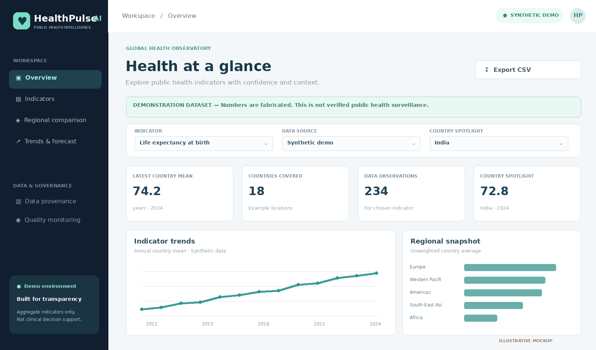
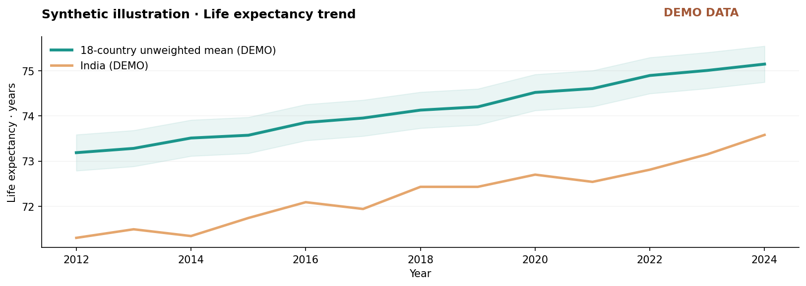
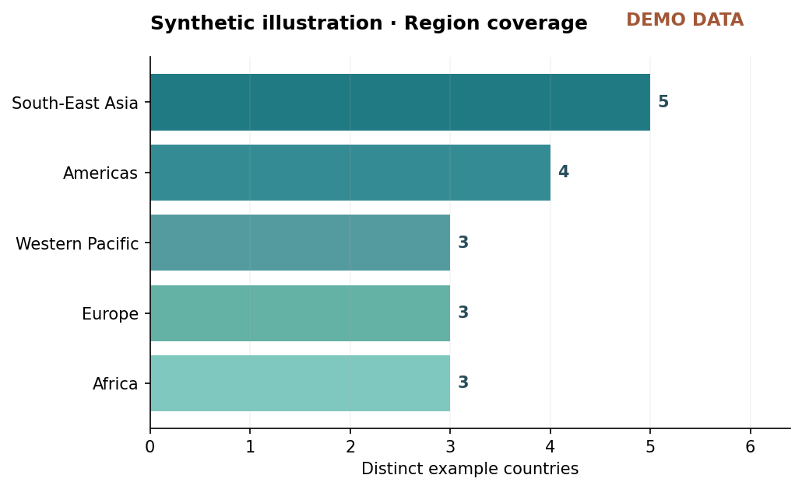
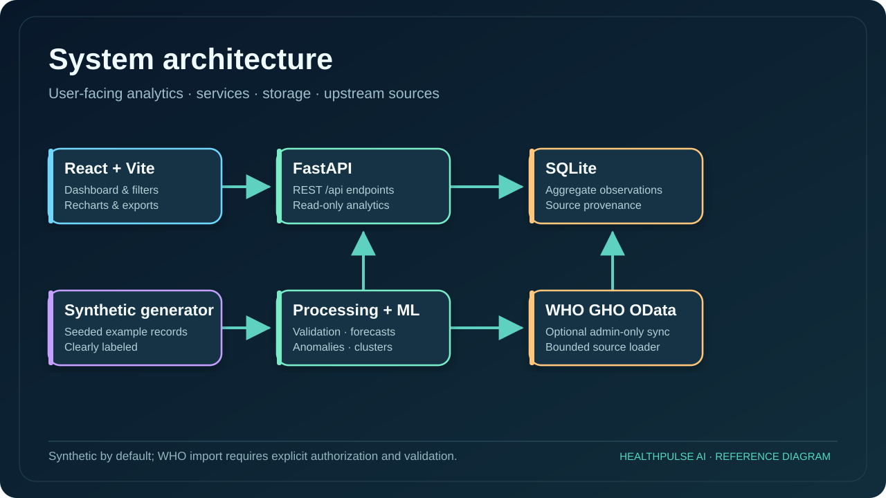
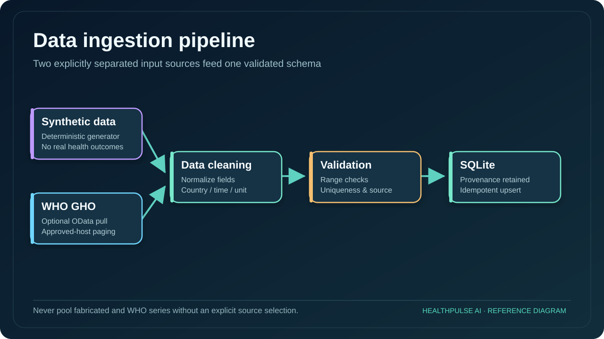
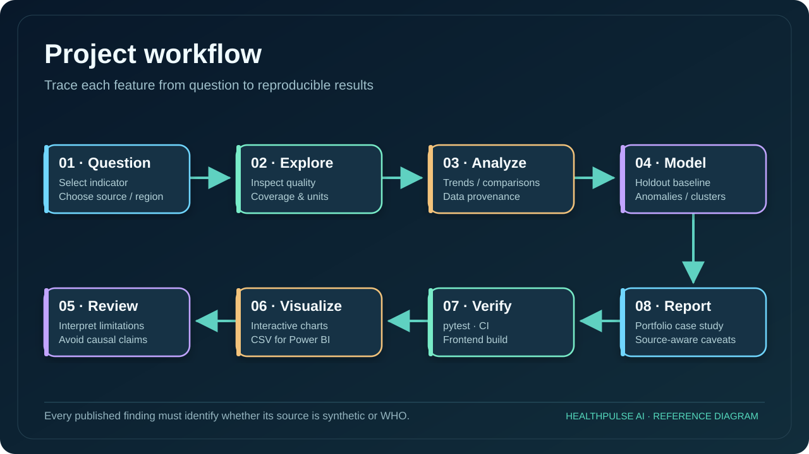

<div align="center">

# 🩺 HealthPulse AI

### Public Health Trends & Resource Intelligence

**Full-stack analytics · WHO GHO integration · Forecasting · Explainable visualizations**



    

**⚠️ Synthetic example data by default — not official surveillance or clinical decision support.**

</div>

## Overview

An analytics and visualization application for longitudinal aggregate public health indicators. Uses fabricated records for a reproducible demo; verified WHO GHO aggregates can be imported with an explicitly authorized request and are kept separate from synthetic records.



## Features

| Capability | Implementation |
|---|---|
| Intelligence dashboard | 4 KPI cards, interactive charts, country and data-source selectors plus interactive provenance, quality and resource-context views |
| Trend analysis | Annual country/region trends, unit-aware views |
| Regional comparison | Unweighted means with country counts and methodology warnings |
| Machine learning | Ridge time-trend projection with chronological MAE and naive baseline |
| Anomaly detection | Robust MAD year-over-year change flags |
| Exploratory clustering | Scaled KMeans over complete country indicator matrix |
| Data validation | Canonical indicator ranges, ISO-style country codes, source separation |
| Provenance | Interactive provenance and coverage pages, source URLs, quality endpoint, ingestion time, CSV export |
| Deployment | Docker Compose API + Nginx React app, named SQLite volume |
| Testing | API and algorithm tests, frontend build CI |

## Visual atlas · 10 original project figures

The dashboard and data charts below are **synthetic demonstrations**. The seven SVG diagrams illustrate real code structure and workflows; none represent measured public-health outcomes.

| Dashboard | Trend example |
|---|---|
|  |  |







Additional visuals: [database schema](assets/diagrams/04-observation-schema.svg) · [forecast evaluation](assets/diagrams/05-forecast-evaluation.svg) · [API lifecycle](assets/diagrams/06-api-data-lifecycle.svg) · [repository tree](assets/diagrams/07-project-tree.svg). All ten are indexed in [the visual gallery](docs/VISUAL_GALLERY.md).

## Screenshots and diagrams


- [Architecture and data-flow diagrams](docs/ARCHITECTURE.md)
- [Model card and limitations](docs/MODEL_CARD.md)
- [Data dictionary](docs/DATA_DICTIONARY.md)
- [Security notes](docs/SECURITY.md)
- [Portfolio case study](docs/PORTFOLIO_CASE_STUDY.md)


## Interactive public showcase (synthetic only)

[Explore the browser demo](https://harshakavali81-collab.github.io/harshavardhan-portfolio/healthpulse-demo.html) — works without a backend, with fabricated values and indicator/country/year filters. **This separate static showcase is not a deployment of FastAPI, does not access WHO, and is not the application’s actual seeded database.** Run Docker Compose for the full platform.

## Quick start with Docker

```bash
cp .env.example .env
# Edit ADMIN_API_KEY in .env only if you want to enable WHO imports.
docker compose up --build
```

Open **http://localhost:8080** for the React dashboard and **http://localhost:8000/docs** for interactive FastAPI documentation.

## Run without Docker

```bash
python -m venv .venv
# Activate your virtual environment
pip install -r requirements.txt
PYTHONPATH=src:. uvicorn backend.app.main:app --reload
# In a second terminal
cd frontend
npm install --no-audit --no-fund
npm run dev
```

Use `http://localhost:5173` for the frontend in development. On Windows PowerShell, run `$env:PYTHONPATH="src;."; uvicorn backend.app.main:app --reload` from the project root.

## WHO import — optional, explicit, admin-only

WHO GHO OData docs: https://www.who.int/data/gho/info/gho-odata-api

```bash
# Put a long random key into your untracked .env, then restart the API.
curl -X POST http://localhost:8000/api/admin/sync-who/life_expectancy \
  -H 'X-Admin-Key: YOUR_PRIVATE_ADMIN_KEY'
# Switch dashboard Data source to 'WHO GHO (if synced)'.
```

The loader pages through bounded WHO OData responses, accepts total-population values only, keeps original provenance and drops records outside indicator validation ranges. Currently configured WHO codes are examples that must be checked against the current indicator catalogue. Networking, source changes, missingness and disaggregation may limit import success. A live feed is **not** preconfigured or claimed. Different countries may have different observation years.

## API examples

```bash
curl 'http://localhost:8000/api/health'
curl 'http://localhost:8000/api/indicators'
curl 'http://localhost:8000/api/records?indicator=immunization&source=synthetic'
curl 'http://localhost:8000/api/regional-comparison?indicator=life_expectancy'
curl 'http://localhost:8000/api/forecast?indicator=life_expectancy&country=IND&horizon=3'
curl 'http://localhost:8000/api/anomalies?indicator=immunization&country=NGA'
curl 'http://localhost:8000/api/clusters'
curl 'http://localhost:8000/api/quality'
curl 'http://localhost:8000/api/resources'
```

## Data quality and operations

The dashboard includes interactive **Data provenance**, **Quality monitoring** (country-year gaps) and **Resource context** views. Their corresponding API endpoints are documented in `/docs`.

SQLite integrity and consistent backups:

```bash
python scripts/db_maintenance.py verify
python scripts/db_maintenance.py backup --output backups/healthpulse-YYYYMMDD.sqlite
```

See [backup and recovery guide](docs/OPERATIONS.md).

## Testing

```bash
PYTHONPATH=src:. pytest -q
cd frontend && npm install --no-audit --no-fund && npm run build
```

## Repository map

```text
HealthPulse-AI/
├── README.md, requirements.txt, docker-compose.yml, Dockerfile
├── src/healthpulse/
│   ├── ingestion/         # WHO OData + synthetic demo
│   ├── processing/        # Validation, cleaning, aggregation
│   ├── analytics/         # Descriptive analysis, regional comparisons
│   ├── models/            # Forecast, anomalies, clustering
│   └── monitoring/        # Data quality
├── backend/app/           # FastAPI + SQLite
├── frontend/src/          # React dashboard / views / Recharts
├── notebooks/             # Three reproducible walkthroughs
├── docs/                  # Architecture / data dictionary / governance
├── powerbi/               # CSV import and DAX recipe
├── assets/                # Real demo renders and chart examples
├── tests/                 # API, data, ingestion and model checks
└── .github/workflows/     # Continuous integration
```

## Use responsibly

This prototype deliberately separates WHO and synthetic records and makes no patient-specific predictions. Resource-density charts are **not** verified estimates of resource shortage. Forecasts do not have calibrated uncertainty or epidemiological validation. Regional averages are unweighted and should not be interpreted as published WHO regional estimates. Use authoritative metadata, local statistical expertise and revised data for any real policy question.

## Author

**Kavali Harshavardhan** — AI/ML and Data Analytics portfolio project · [GitHub profile](https://github.com/harshakavali81-collab)

*UI is an original dashboard implementation, drawing only general inspiration from modern healthcare analytics design patterns.*
