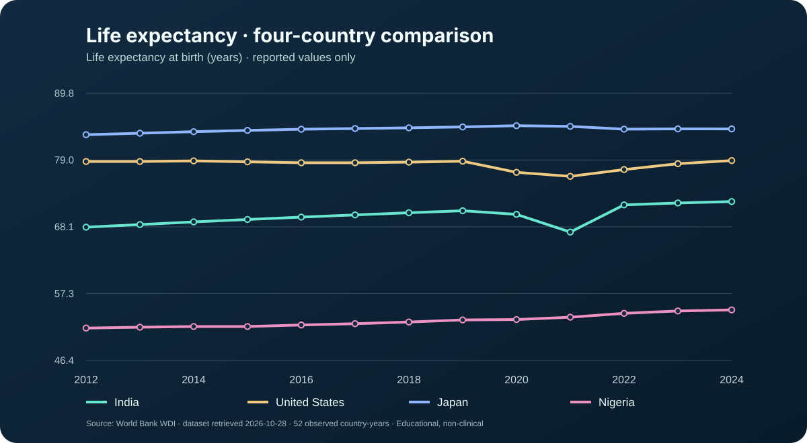
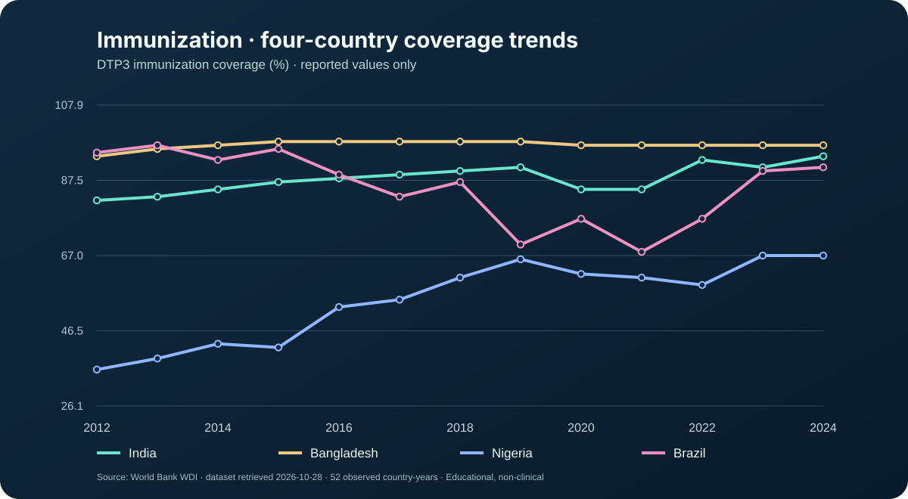
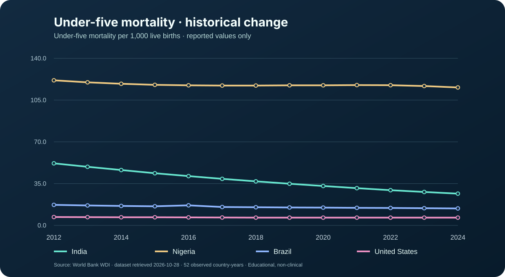
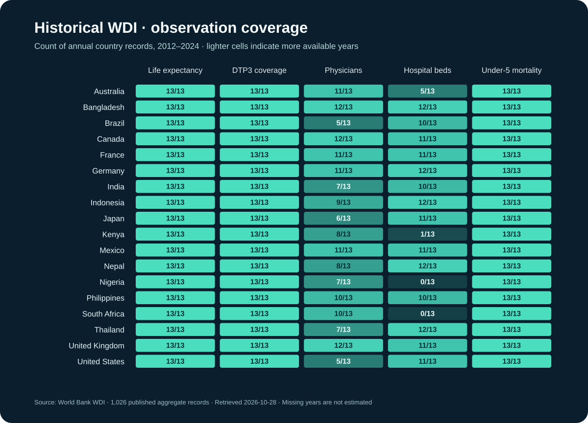

# Real historical WDI visual gallery

The charts below are based on the [published World Bank WDI dataset](../data/public/worldbank-wdi-2012-2024.json), not the synthetic demo. The corresponding [source manifest](../data/public/worldbank-manifest.json) reports **1,026 observations**, five indicator categories and 18 represented countries for the requested 2012–2024 period.

These illustrations were generated from the verified project snapshot; each observation is plotted only when reported. Values are not filled, interpolated or inferred for missing years. They are descriptive educational charts, **not a medical diagnosis, WHO-branded chart, or a policy recommendation**.

## Life expectancy


## DTP3 immunization coverage


## Under-five mortality


## Country/indicator coverage


**Source note:** World Bank World Development Indicators API (series SP.DYN.LE00.IN, SH.IMM.IDPT, SH.DYN.MORT and coverage statistics for SH.MED.PHYS.ZS and SH.MED.BEDS.ZS). Retrieved on 28 October 2026. Underlying publishers and year availability vary across indicators; definitions and rates may be revised.

References: [World Bank API documentation](https://datahelpdesk.worldbank.org/knowledgebase/articles/889392) · [Project data dictionary](DATA_DICTIONARY.md) · [Validation plan](VALIDATION_PLAN.md).

## Visualization provenance manifest

```json
{
  "provider": "World Bank WDI",
  "retrieved_on": "2026-10-28",
  "snapshot_sha256": "3cc1ac60093f54509bce753861c03c4fccc166b15f25f56f4a5bda238fb532de",
  "charts": [
    {
      "path": "assets/real-data/01-life-expectancy.svg",
      "indicator": "life_expectancy",
      "countries": [
        "IND",
        "USA",
        "JPN",
        "NGA"
      ],
      "rows": 52,
      "title": "Life expectancy · four-country comparison"
    },
    {
      "path": "assets/real-data/02-dtp3-immunization.svg",
      "indicator": "immunization",
      "countries": [
        "IND",
        "BGD",
        "NGA",
        "BRA"
      ],
      "rows": 52,
      "title": "Immunization · four-country coverage trends"
    },
    {
      "path": "assets/real-data/03-under-five-mortality.svg",
      "indicator": "under5_mortality",
      "countries": [
        "IND",
        "NGA",
        "BRA",
        "USA"
      ],
      "rows": 52,
      "title": "Under-five mortality · historical change"
    },
    {
      "path": "assets/real-data/04-country-indicator-coverage.svg",
      "indicator": "coverage_counts",
      "countries": 18,
      "rows": 1026,
      "title": "WDI country and indicator coverage matrix"
    }
  ]
}
```
