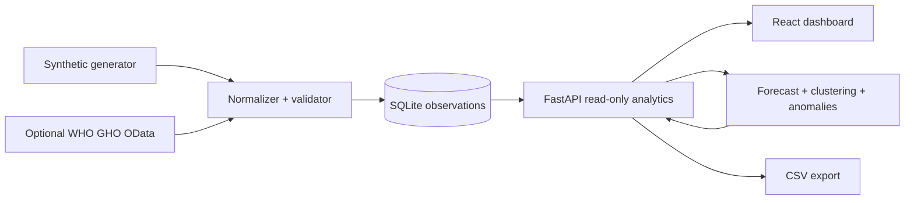
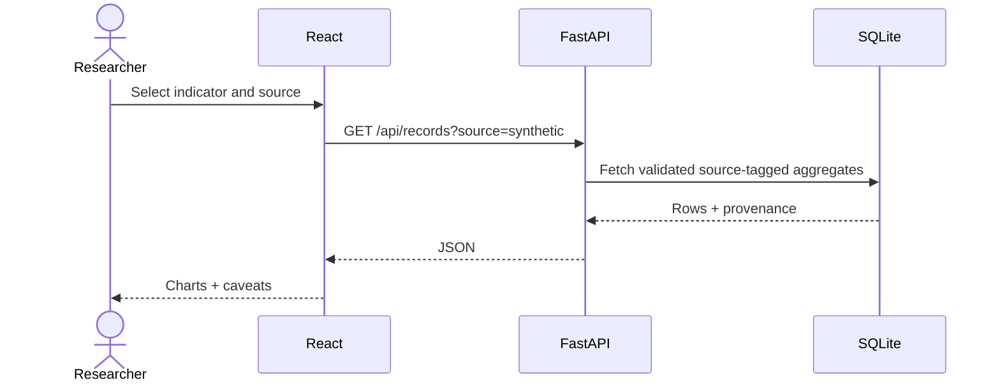
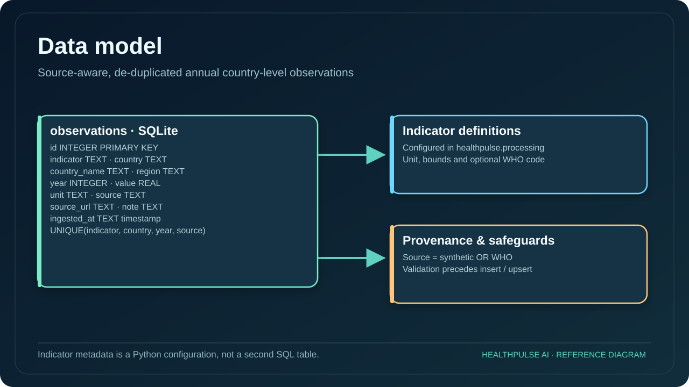
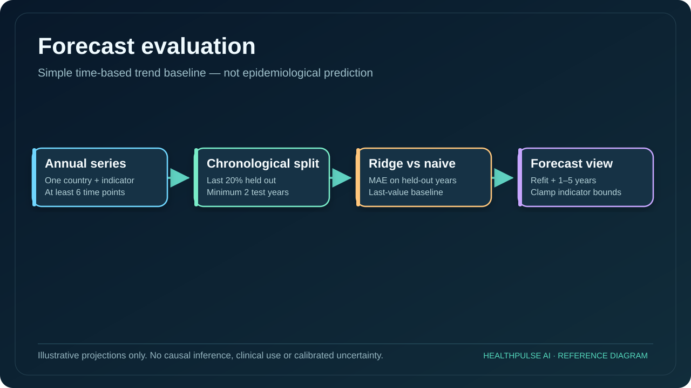
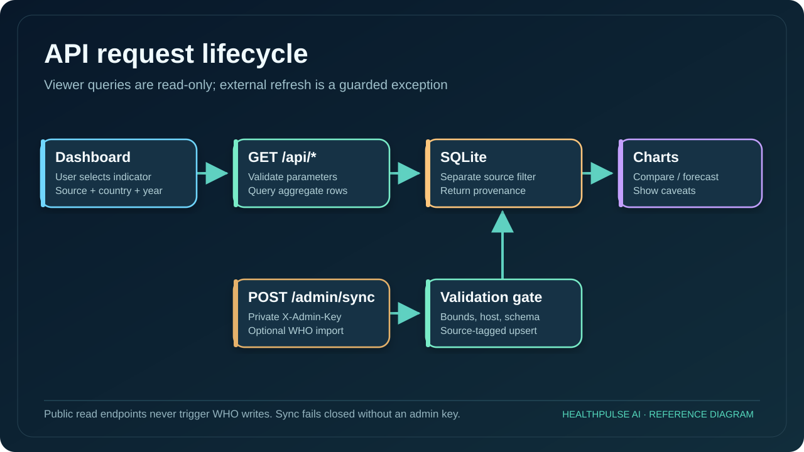
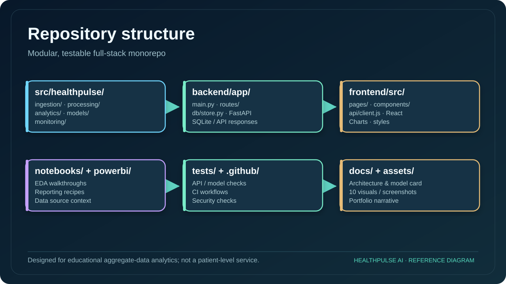

# Project structure, data flow and pipelines

## Key implementation boundaries

1. `src/healthpulse/ingestion/`: deterministic synthetic seed and optional WHO GHO OData ingestion.
2. `src/healthpulse/processing/`: clean, validate and guard indicator units, values, geography and source.
3. `backend/app/db/store.py`: upsert into SQLite on `(indicator, country, year, source)`; preserve source URL and ingestion timestamp.
4. `backend/app/main.py`: read-only REST analytics, forecasting, clustering, anomaly and quality endpoints; guarded WHO refresh.
5. `frontend/src/`: source-aware filter controls, four React views and data exports.
6. `tests/`: deterministic validation, API, model and source-adapter checks; GitHub Actions checks Python and frontend build.

## Upstream ingestion DAG

## User query sequence

## Modeling boundaries

A per-country, per-indicator Ridge regression fits annual values. Chronological held-out MAE is compared with a last-observation naive baseline. The model refits on all available years for 1–5-year illustrative extrapolation, clamped to configured indicator bounds. Cluster and anomaly flags are *exploratory*, not policy recommendations or clinical predictions.

## Diagrams

See [data dictionary](DATA_DICTIONARY.md), [model card](MODEL_CARD.md), [security](SECURITY.md), [visual gallery](VISUAL_GALLERY.md), and the root README.
